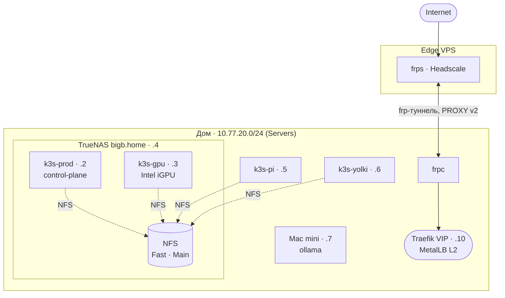

# Home GitOps Repository

Декларативные манифесты домашнего кластера k3s. Всё применяет **Flux CD**.

## Кластер

| Узел | Роль | Железо | Особенности |
|------|------|--------|-------------|
| k3s-prod | control-plane | VM на TrueNAS | локальный ZFS (`zvol-local`): БД, Prometheus, GitLab |
| k3s-gpu | worker | VM на TrueNAS | Intel iGPU (QSV): Jellyfin, ML Immich |
| k3s-yolki | worker | N100 | Frigate (Coral USB), Mosquitto, Zigbee2MQTT, Home Assistant |
| k3s-pi | worker | Raspberry Pi | arm64, резервный L2-лидер MetalLB |

k3s v1.34, Ubuntu 24.04. Домены: внешние `progist.ru`, `novozhenin.ru`, внутренний `*.home`.



## Сеть

Подсети `10.77.<VLAN>.0/24`. Роутер Keenetic, коммутатор HP 5130. Management — untagged VLAN 1.

| VLAN | Сегмент | Что там |
|------|---------|---------|
| 1 | Management | роутер `.1`, коммутатор `.2` |
| 20 | Servers | узлы кластера, TrueNAS, Mac mini, VIP Traefik |
| 30 | Home | компьютеры, телефоны |
| 40 | IoT | SLZB, умный дом |
| 50 | CCTV | камеры |
| 60 / 90 | Media / Guest | |

Адреса в Servers: `.2` prod, `.3` gpu, `.4` bigb (NFS), `.5` pi, `.6` yolki, `.7` Mac mini (ollama), `.10` VIP Traefik.
DNS клиентам отдают Blocky на prod/gpu/pi (`.2/.3/.5`), он же резолвит `*.home`.

Сервисы Keenetic (веб-интерфейс, SNMP) доступны с адреса `10.77.10.1`, а не из сегмента Servers.

## Структура репозитория

```
clusters/home/   — точка входа Flux: Kustomization'ы и их порядок (dependsOn)
namespaces/      — Namespace
sealed-secrets/  — зашифрованные секреты (apps/, infra/, cluster/, gitlab/)
infra/           — Traefik, MetalLB, StorageClasses, MinIO, K8up, CrowdSec, CNPG, tailscale, frpc,
                   proxy/ (не-k8s сервисы), edge/ (VPS: ansible + compose), nodes/
helm/            — HelmRepository и HelmRelease
apps/            — пользовательские приложения, nfs-provisioner, renovate
monitoring/      — kube-prometheus-stack, Loki, Promtail, правила алертов, exporters
cluster-addons/  — CoreDNS DaemonSet (kube-system)
cluster-config/  — cert-manager ClusterIssuers
gitlab/          — GitLab CE и runner
parapar-dr/      — DR-реплика БД проекта Parapar
charts/          — локальный chart pvc-archiver
docs/            — recovery, k8up-restore, truenas-exporters, заметки по переезду
scripts/         — вспомогательные скрипты
backup/          — бинарники TrueNAS exporters
```

Добавить приложение: каталог в `apps/<name>/` (deployment, service, ingress, storage) и строка в `apps/kustomization.yaml`.

## Как это работает

1. Пуш идёт в локальный GitLab (`gitlab.home`), он зеркалит репозиторий на GitHub.
2. Flux тянет **GitHub** (`GitRepository flux-system`, ветка `main`) и применяет Kustomization'ы из `clusters/home/`.
3. Порядок и зависимости задаются `dependsOn` в файлах `clusters/home/*.yaml` (`flux get kustomizations`).
4. CI (`.gitlab-ci.yml`) валидирует манифесты через `kubeconform`.
5. Renovate (CronJob в кластере) присылает MR с обновлениями образов и чартов.

Проверка локально, как в CI:

```sh
kubectl kustomize ./apps | kubeconform -strict -ignore-missing-schemas -summary -kubernetes-version 1.33.0
```

## Внешний доступ

Провайдер за CGNAT, поэтому весь публичный трафик идёт через VPS:

- **HTTP/HTTPS и почта:** клиент → VPS (`frps`) → `frpc` в кластере → Traefik. Настоящий IP клиента передаётся по PROXY protocol v2 (Traefik принимает его только от адресов нод).
- **Админский доступ и метрики:** tailnet на Headscale (`hs.progist.ru`). Кластер анонсирует подсеть `10.77.20.0/24` через `tailscale-router` (prod и pi).
- **VIP Traefik** `10.77.20.10` держит MetalLB (L2, спикеры на prod и pi). Порты 80, 443, 22 (SSH GitLab), почта.
- **Конфигурация VPS:** `infra/edge/` (ansible + docker compose), применяется вручную `ansible-playbook site.yml`.

## TLS и Ingress

Ingress делится на два типа:

```yaml
# Internal (*.home), самоподписанный Root CA
cert-manager.io/cluster-issuer: root-ca-issuer
traefik.ingress.kubernetes.io/router.middlewares: infra-redirect-to-https@kubernetescrd
# tls: hosts: [app.home], secretName: app-internal-tls

# External (*.progist.ru), Let's Encrypt
cert-manager.io/cluster-issuer: letsencrypt-prod
traefik.ingress.kubernetes.io/router.middlewares: infra-redirect-to-https@kubernetescrd
# tls: hosts: [app.progist.ru], secretName: app-external-tls
```

Общие middleware лежат в `infra/traefik-middleware/`.

## Секреты

Только **SealedSecrets** (kubeseal), расшифровать их можно только в кластере.

```sh
kubeseal --cert cert.pem <secret.yaml> -o yaml > sealed.yaml   # запечатать
# commit → Flux применит
```

Ротация: распечатать (`--recovery-unseal`), поправить значение, запечатать заново.

## Хранилище

PV на NFS (TrueNAS `bigb.home`), опции `nfsvers=4.1,hard,rsize=65536,wsize=65536`. Reclaim везде `Retain`.

| StorageClass | Назначение |
|---|---|
| `nfs-nvme-manual`, `nfs-nvme-db-manual` | БД, критичные конфиги (NVMe) |
| `nfs-hdd-manual`, `nfs-hdd-manual-media` | медиа, большие файлы (HDD) |
| `nfs-nvme-dynamic`, `nfs-hdd-dynamic` | кэш и временные данные (`nfs-subdir-external-provisioner`) |
| `hostpath-manual` | временные данные GPU |
| `zvol-local` | локальный ZFS, только k3s-prod |

## Базы и бэкапы

- **PostgreSQL** (общий кластер `apps-pg`) под CloudNativePG; WAL и бэкапы в MinIO (barman-cloud). DR-реплика Parapar в `parapar-dr/`.
- **MySQL и одиночный Postgres** снимаются через `k8up.io/backupcommand` (`mysqldump`, `pg_dumpall`).
- **K8up** (restic) снимает PVC по меткам:

| Schedule | Частота | Куда | Что |
|---|---|---|---|
| `backup-critical-hourly` | каждый час | MinIO | `backup-level: critical\|hourly` |
| `backup-important-daily` | `0 4 * * *` | MinIO | `backup-level: important\|daily` |
| `backup-important-daily-offsite` | `0 4 * * *` | Backblaze B2 | все с `backup-offsite: "true"` |
| `backup-monitoring-daily` | `0 4 * * *` | MinIO | namespace monitoring |

- **pvc-archiver** (`charts/pvc-archiver/`) — tar-архив конфигов PVC в `backups-pvc`, по HelmRelease на приложение.

Включить PVC в бэкап:

```yaml
labels:
  backup-level: critical      # или important, daily
  backup-offsite: "true"      # опционально, в Backblaze
annotations:
  k8up.io/backup: "true"
```

Восстановление: `docs/k8up-restore.md`.

## Мониторинг

- **kube-prometheus-stack:** Prometheus, Alertmanager, Grafana (`grafana.progist.ru`). Правила в `monitoring/kube-prometheus-stack/rules/`, цели в `scrapeconfigs/`.
- **Loki + Promtail:** логи подов и journal нод (warning+). Внешние агенты (TrueNAS, VPS) пишут в `loki.home`.
- **Uptime Kuma** (MariaDB, метрики в Prometheus), **Gatus** (`status.home`).
- **Dead man's switch:** Watchdog → Cronitor.
- **Алерты:** `fatal` → alerter на VPS → Telegram, при отсутствии подтверждения звонок. `critical`/`warning` → Telegram, `info` без звука.

## Безопасность

**CrowdSec**: агенты на всех нодах читают логи Traefik и приложений, LAPI на k3s-prod хранит решения. Bouncer Traefik стоит глобально на entrypoint (в ingress не виден), на prod и pi дополнительно firewall-bouncer'ы на самих нодах (вне Flux, примеры в `infra/nodes/crowdsec/`).

## Автообновления

**Renovate** (self-hosted, CronJob каждые 6 часов, `apps/renovate/`): patch и minor сливаются автоматически, major только вручную. Исключено `sealed-secrets/**`.

## Не-k8s сервисы

Сервисы вне кластера проксируются через headless Service + Endpoints + Ingress в `infra/proxy/`:

```yaml
kind: Service      # clusterIP: None, port 80 -> 8080
---
kind: Endpoints    # subsets: addresses: [{ ip: 10.77.20.X }], ports: [{ port: 8080 }]
```

Сейчас: ollama (`10.77.20.7:11434`, LLM для open-webui и immich-ML), роутер (`10.77.10.1`), принтер.

## GPU

```yaml
nodeSelector:
  node.hardware.gpu: intel-igpu
tolerations:
  - key: node.hardware.gpu
    value: intel-igpu
    effect: NoSchedule
```

Применяется к Jellyfin, ML Immich и другим, кому нужен iGPU.

## CoreDNS

Управляется Flux как **DaemonSet** (`cluster-addons/`), не k3s. Поэтому на k3s-prod в `/etc/rancher/k3s/config.yaml` должно быть:

```yaml
disable:
  - coredns
  - servicelb
kubelet-arg:
  - "max-pods=250"
```

Без `disable: coredns` k3s пересоздаёт свой CoreDNS при рестарте, и DNS временно ломается. `servicelb` выключен, LoadBalancer обслуживает MetalLB.

## Disaster Recovery

```sh
flux bootstrap git --url=<repo> --branch=main --path=clusters/home
```

Чек-лист после bootstrap:

1. `kubectl get ds coredns -n kube-system`: по одному поду на узел
2. DNS резолвит имена, Traefik запущен, cert-manager issuer'ы `Ready`
3. NFS-тома монтируются (`bigb.home`), SealedSecrets расшифровываются
4. `flux get kustomizations`: все `Ready`
5. GPU: `kubectl get nodes -o custom-columns=NAME:.metadata.name,GPU:.status.allocatable.gpu\\.intel\\.com/i915`

Recovery-поды для ручного ремонта БД:

```sh
kubectl apply -f docs/recovery/mysql-recovery-pod.yaml      # mysql-data-pvc
kubectl apply -f docs/recovery/postgres-recovery-pod.yaml   # postgres-data-pvc
# exec, починить, затем kubectl delete -f ...
```

TrueNAS exporters после переустановки: `docs/truenas-exporters.md`.
